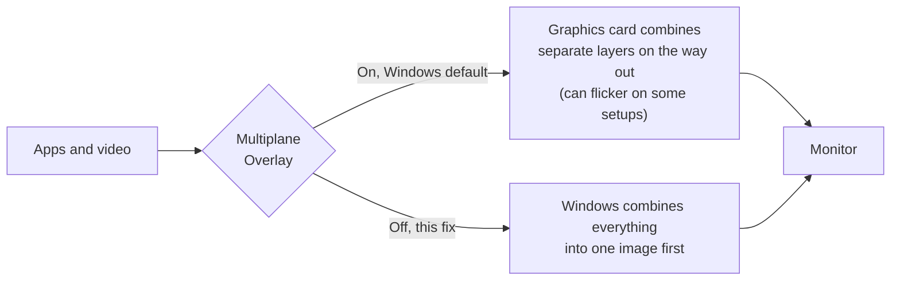

<div align="center">

# Fix-Flickering-MPO

**Stop screen flickering on Windows 10 and 11 by turning off Multiplane Overlay (MPO).**

One registry value · One restart · Undo anytime

[](https://github.com/LeerBox/Fix-Flickering-MPO/releases/latest)
[](#compatibility)
[](LICENSE)

[](https://github.com/LeerBox/Fix-Flickering-MPO/releases/latest/download/Fix-Flickering-MPO.reg)
&nbsp;
[](https://github.com/LeerBox/Fix-Flickering-MPO/releases/latest/download/Undo-Fix-Flickering-MPO.reg)

[Quick start](#quick-start) · [How it works](#how-it-works) · [Verify](#verify) · [Undo](#undo) · [Troubleshooting](#troubleshooting) · [FAQ](#faq)

</div>

---

## Overview

My screen kept flickering while **AdGuard for Windows** was running. Turning off a Windows display feature called **Multiplane Overlay (MPO)** fixed it, and AdGuard keeps running as normal.

This repo packages that fix, a one-click undo, and what you should know before you use it.

> [!NOTE]
> This is the same registry value NVIDIA provides as its official workaround for MPO flicker ([support article 5157](https://nvidia.custhelp.com/app/answers/detail/a_id/5157)).

## Is this for you?

The fix is likely to help if you see any of these:

- The screen flickers while AdGuard for Windows is running
- Black flashes on the desktop or inside app windows
- Flicker or stutter while moving or resizing windows
- Flicker in videos, browsers, or streaming and remote desktop windows
- Problems that only appear with more than one monitor, especially at different refresh rates

## Quick start

1. **Download** [`Fix-Flickering-MPO.reg`](https://github.com/LeerBox/Fix-Flickering-MPO/releases/latest/download/Fix-Flickering-MPO.reg).
2. **Double-click** it, then click **Yes** → **Yes** → **OK**.
3. **Restart** your PC.

> [!IMPORTANT]
> The fix takes effect only after a restart.

> [!TIP]
> Your browser may warn that `.reg` files can harm your device. That's a generic warning for registry files. Open this one in Notepad and you'll see it's only four lines.

<details>
<summary><b>Prefer the command line?</b></summary>

From a terminal opened as administrator:

```bat
reg add "HKLM\SOFTWARE\Microsoft\Windows\Dwm" /v OverlayTestMode /t REG_DWORD /d 5 /f
```

Then restart your PC.

</details>

## How it works

Windows has two ways to put together the picture you see. By default it uses **MPO**: the graphics card gets separate layers, such as a video and the rest of the desktop, and combines them as the image goes out to the monitor. That saves power and lowers latency. But some combinations of graphics card, driver, monitor and app don't handle it well, and the result is flicker.

This fix turns MPO off, so Windows combines everything into one image itself before sending it out.



### What the file changes

```reg
Windows Registry Editor Version 5.00

[HKEY_LOCAL_MACHINE\SOFTWARE\Microsoft\Windows\Dwm]
"OverlayTestMode"=dword:00000005
```

| Line | What it does |
|---|---|
| `Windows Registry Editor Version 5.00` | Tells Windows this is a registry file. |
| `[HKEY_LOCAL_MACHINE\SOFTWARE\Microsoft\Windows\Dwm]` | Opens the settings key of the Desktop Window Manager, the part of Windows that draws the desktop. It's machine-wide, so it applies to every user and needs admin rights. |
| `"OverlayTestMode"=dword:00000005` | Creates a 32-bit value named `OverlayTestMode`, set to `5`, which tells Windows not to use MPO. |

That's the whole change. Nothing is deleted or installed, and nothing runs in the background.

## Trade-offs

| | MPO on (Windows default) | MPO off (this fix) |
|---|---|---|
| Who combines the layers | The graphics card | Windows |
| On affected setups | Flickers | No flicker |
| GPU work during video | Lowest | Slightly higher (a little less laptop battery life during video) |
| Borderless games with an overlay on top | Normal input lag | Input lag can be slightly higher |
| AdGuard and other apps | Work normally | Work normally |

## Verify

Run this in any terminal:

```bat
reg query "HKLM\SOFTWARE\Microsoft\Windows\Dwm" /v OverlayTestMode
```

| Output | Meaning |
|---|---|
| `OverlayTestMode    REG_DWORD    0x5` | The fix is on. |
| `ERROR: The system was unable to find the specified registry key or value.` | The fix is off (Windows default). |

> [!NOTE]
> Don't rely on `dxdiag`. Its `MPO MaxPlanes` line can still show a number above 1 with the fix on. On the test PC it shows 3, and the flicker is gone.

## Undo

1. **Download** [`Undo-Fix-Flickering-MPO.reg`](https://github.com/LeerBox/Fix-Flickering-MPO/releases/latest/download/Undo-Fix-Flickering-MPO.reg).
2. **Double-click** it, then click **Yes** → **Yes** → **OK**.
3. **Restart** your PC.

It deletes `OverlayTestMode`, which puts Windows back to its default with MPO on.

<details>
<summary><b>Prefer the command line?</b></summary>

From a terminal opened as administrator:

```bat
reg delete "HKLM\SOFTWARE\Microsoft\Windows\Dwm" /v OverlayTestMode /f
```

Then restart your PC.

</details>

## Troubleshooting

| What you see | What to do |
|---|---|
| Nothing changed after applying the fix | Make sure you restarted, then run the check in [Verify](#verify). |
| The check doesn't show `0x5` | Apply the fix again and click **Yes** on the administrator prompt. |
| The check shows `0x5`, but the screen still flickers | Your flicker may have a different cause. Some people also report that certain Windows 11 24H2 and 25H2 builds ignore this value. Undo the fix and update your graphics driver. |
| The flicker came back after a Windows update | Run the check and apply the fix again if needed. |

Still stuck? [Open an issue](https://github.com/LeerBox/Fix-Flickering-MPO/issues) with your Windows build, graphics card and driver version.

## FAQ

<details>
<summary><b>Is it safe?</b></summary>

It changes one registry value, it's the same workaround NVIDIA provides, and the undo file removes it completely.

</details>

<details>
<summary><b>Do I need an NVIDIA graphics card?</b></summary>

No. MPO is a Windows feature and Windows itself reads this value, so it applies to NVIDIA, AMD and Intel graphics alike.

</details>

<details>
<summary><b>Do I have to uninstall AdGuard?</b></summary>

No. AdGuard keeps running. Only MPO is turned off.

</details>

<details>
<summary><b>Why is it called "OverlayTestMode"?</b></summary>

That's the name Windows uses internally. Microsoft doesn't document the value, but it's the one NVIDIA tells its users to set for this problem.

</details>

<details>
<summary><b>Will it survive updates?</b></summary>

It's a normal registry value, so it should. If the flicker comes back, for example after a major Windows update, run the check in [Verify](#verify) and apply the fix again if needed.

</details>

## Compatibility

It should work on Windows 10 and 11 with any graphics card, because MPO is part of Windows. Tested on:

| | |
|---|---|
| Windows | Windows 11 Pro 26H2, build 26300.9818 |
| Graphics card | NVIDIA GeForce RTX 5090, driver 621.14 |
| Monitors | 2 (main monitor at about 280 Hz) |
| App that caused the flicker | AdGuard for Windows 8.0.5595 |

## Credits

- **[LeerBox](https://github.com/LeerBox)** found that this fixes the AdGuard flicker, tested it, and made this repo.
- **NVIDIA** published the `OverlayTestMode` value as an official workaround in [support article 5157](https://nvidia.custhelp.com/app/answers/detail/a_id/5157).

## License

Released under the [MIT License](LICENSE).

---

<div align="center">

If this fixed your flicker, a ⭐ helps other people find it.

</div>
